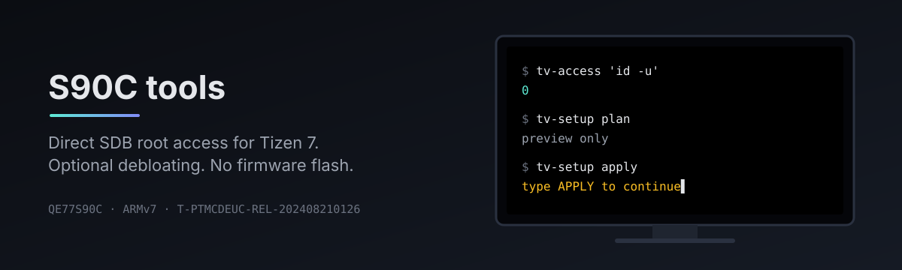

# S90C tools



Linux tools for root commands and app cleanup on the Samsung S90C.
Uses [chris-ritsen's archive-root bootstrap](https://github.com/chris-ritsen/samsung-tv-root).

Tested on **QE77S90CATXXN (QE77S90C), Tizen 7 / ARMv7**, firmware 2000.2,
build `T-PTMCDEUC-REL-202408210126`. Other builds are untested.

## Root access

Use a trusted LAN. Turn off automatic firmware and app updates before starting.
**Do not update, downgrade or flash firmware to match this build.**
Read [the risks](SECURITY.md), then enable Developer Mode with your computer's
LAN IP ([instructions](docs/usage.md#developer-mode)).

```sh
git clone https://github.com/invaliddayta/s90c-tools.git
cd s90c-tools
export TV_HOST=192.0.2.10  # replace with your TV's address
nix run .#tv-access -- --probe
nix run .#tv-access -- 'id -u'  # must print 0
```

Without Nix, use `./tools/tv_access/tv-access` with Python 3, Bash and OpenSSL.
No Tizen Studio or developer certificate is needed.

Root access was tested across a normal reboot. Once SDB returns, each command
automatically gets root again. No custom boot service is installed.
SMACK/UEP and read-only filesystem restrictions still apply.

## Commands

| Command | Purpose |
|---|---|
| `tv-access 'command'` | Root command with stdout, stderr and exit status |
| `tv-key XF86Home` | Remote-control key input |
| `tv-shot /tmp/tv.png` | Compositor screenshot, not protected video |
| `tv-setup plan/apply/verify` | Preview, apply or check selected settings and app removals |

Run commands with `nix run .#COMMAND -- ...`, or install the
[local symlinks](docs/usage.md#local-installation).

## Optional app cleanup

The default profile selects 24 ad components and Ambient themes.
Streaming apps and device integrations are kept unless you select them.

```sh
mkdir -p local
cp profiles/s90c.json local/my-tv.json
# Read the consequences and edit remove: true/false.
nix run .#tv-setup -- plan --profile local/my-tv.json
nix run .#tv-setup -- apply --profile local/my-tv.json
nix run .#tv-setup -- verify --profile local/my-tv.json
```

Apply asks for confirmation. App removal can delete data and is not fully
reversible. Run it when nobody is watching. The individual guard controls were
tested on the TV, but the full automated apply workflow has only offline tests.
See [cleanup, guard and recovery](docs/debloat.md).

## Development

```sh
nix develop --no-write-lock-file
nix flake check --no-write-lock-file  # offline tests, no TV access
```

[Usage, builds and root mechanism](docs/usage.md) ·
[Attribution and binary provenance](THIRD_PARTY.md)

First-party code: [MIT](LICENSE). Upstream bootstrap: Unlicense.
Not affiliated with Samsung.
